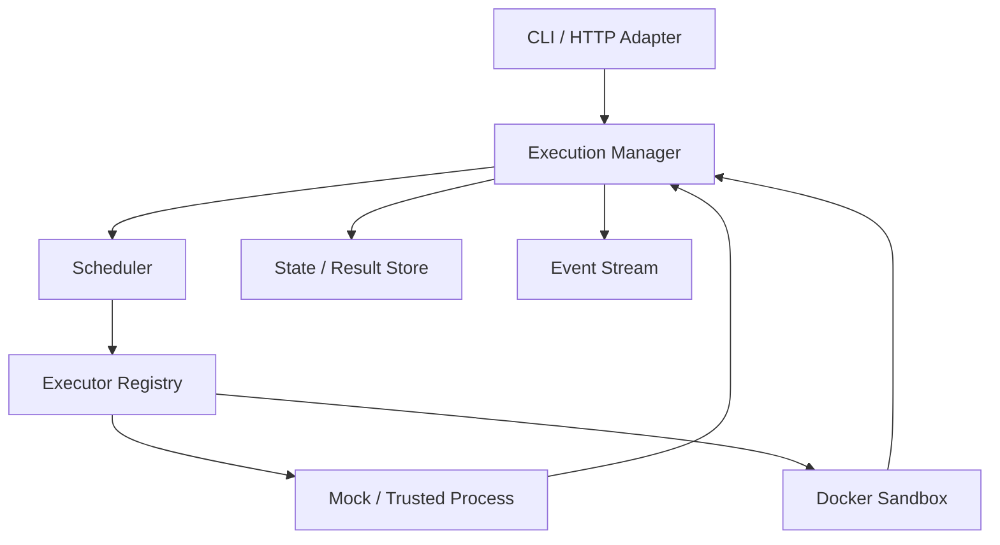
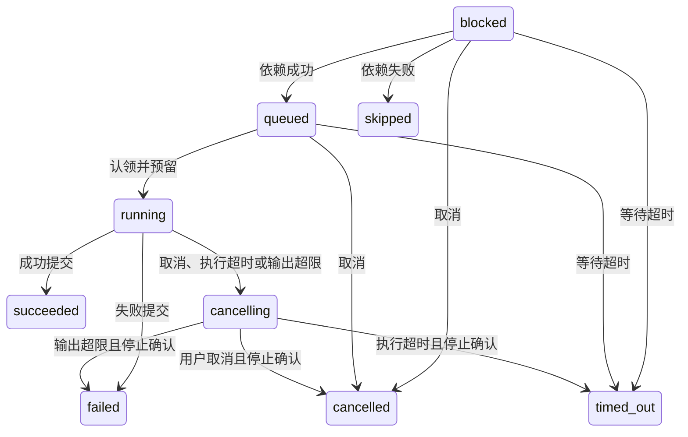

# Toolane 项目需求书

文档版本：0.1  
编写日期：2026-10-09  
适用对象：项目维护者、协作开发者、AI 编程助手  
项目状态：设计阶段，本文描述目标要求，不代表这些能力已经实现。

## 1. 项目定位

**Toolane 是一个使用 Go 开发、面向 Agent 工具调用的通用调度与隔离执行引擎。**

Agent 或上层应用决定调用什么工具、传入哪些参数以及调用之间的依赖；Toolane 负责请求校验、并发调度、执行生命周期、资源限制、结果与事件返回。

项目兼顾两个目标：通过持续实践掌握 Go 并发与服务端开发；形成一个具有清晰接口、可靠性验证和性能实验的开源工程项目。实现范围以可验证的工程问题为中心。

GitHub 仓库建议名称：`toolane`。项目展示名称：`Toolane`。名称由 Tool 与 Lane 组合，表示工具任务进入受控的执行通道。此命名不包含商标或其他命名空间可用性的保证。

## 2. 用户与使用场景

| 用户 | 需求 |
| --- | --- |
| Agent 开发者 | 从 Python、TypeScript 或其他语言提交工具任务，查询结果并取消执行 |
| 服务维护者 | 控制并发、队列和沙箱资源，发现超时、资源泄漏和执行异常 |
| 项目开发者 | 使用 Mock Executor 验证调度逻辑，不依赖真实模型或 Docker |

核心场景：多个 Agent 同时提交工具调用；一批显式有依赖的任务按 DAG 执行；可信本地程序执行；在容器中执行代码；用户取消任务；任务超时；服务重启后协调任务状态与残留容器。

工具可能有外部副作用。终止程序不会撤回已经发送的网络请求、文件修改或外部数据库写入。

## 3. 项目边界

### 3.1 目标范围

- 单机、单服务实例的执行引擎，后续提供 HTTP 服务与 CLI。
- 与 Agent 框架和模型供应商解耦。
- 可替换的 Executor；初期实现 Mock、可信 Process、Docker Sandbox。
- 有界任务队列、并发限制、显式依赖调度、租户级执行配额。
- 可查询的执行状态、超时、取消、受限输出与资源回收。
- V1.0 提供持久化、重启协调、SSE、基础可观测性与可复现实验。

### 3.2 本路线不包含

- LLM 推理、Agent Planning、记忆、Prompt 管理或自动推断工具依赖。
- 自研容器运行时、Kubernetes 集群、跨节点调度、微服务拆分。
- 为展示技术栈而引入 Redis、Kafka 或外部消息队列。
- 任意宿主机 Shell 远程执行、由请求者自行定义容器权限。
- 复杂 Web 管理平台、计费系统、企业身份系统。
- gRPC、沙箱预热池、优先级抢占、自动重试和 gVisor 集成。

最后一组能力可以在测量结果或真实需求支持时单独提案，不能自动视为当前需求。V1.0 是本路线的完整单机版本，不意味着生产级的敌对多租户安全保证。

## 4. 分阶段交付

**初始默认开发目标为 V0.1。未明确变更阶段时，协作 AI 只实现 V0.1。**

| 阶段 | 必须交付 | 暂不要求 | 退出条件 |
| --- | --- | --- | --- |
| V0.1 | 执行协议、工具注册、Mock Executor、可信 Process Executor、有界 FIFO 队列、固定 Worker、状态查询、超时、取消、输出上限、基础 CLI | DAG、Docker、HTTP、持久化 | 单机闭环可运行，生命周期与资源泄漏测试通过 |
| V0.2 | DAG 校验与依赖调度、租户配额、轮询公平调度、原子批次准入、与 FIFO 的实验对比 | 优先级、分布式、输出自动绑定 | 依赖失败传播正确，无超配额调度，公平性实验可复现 |
| V0.3 | Docker Sandbox、资源与权限策略、容器日志限制、强制停止、清理与后台回收、隔离验证 | 任意网络访问、任意镜像、强化隔离运行时 | 超时、OOM、输出洪泛、权限与回收测试通过 |
| V1.0 | HTTP API、身份与授权、SQLite 持久化、提交幂等、重启协调、SSE、指标、Python 调用示例、集成实验 | 多实例共享数据库、自动重试、完整 SDK | API 闭环、崩溃恢复、故障与负载实验通过 |

每阶段可以拆成小里程碑；不可一次生成所有后续阶段的空壳。V0.1—V0.3 默认只有进程内状态，重启会丢失任务记录，需在 README 明确披露。V0.3 即使尚未持久化，也必须能按实例标识识别并回收自己留下的容器。

## 5. 核心概念

| 概念 | 定义 |
| --- | --- |
| Tool | 服务端注册的工具定义，包含名称、参数校验、Executor 类型和固定策略 |
| Execution | 一次工具执行，有独立 ID、状态、输入、结果、时间戳和资源归属 |
| Workflow | V0.2 起支持的一批显式 DAG 节点；节点分别对应 Execution |
| Tenant | 配额与访问控制单位；V1.0 从认证身份获得 |
| Agent ID | 租户内部的来源标记，不具有身份认证作用 |
| Executor | 实际执行工具的组件，不负责决定任务顺序 |
| Reservation | 启动前预留的执行槽位与资源预算 |
| Event | 某次执行的有序状态或输出事件 |

V0.1 使用固定本地租户 `local`。V0.2 的模拟租户由可信测试或本地调用方提供；这不是网络身份验证。

执行记录至少包含 `execution_id`、`tenant_id`、`agent_id`、可选 `workflow_id/node_id`、工具与有效策略、当前状态、稳定错误码、有限结果、时间戳、资源归属及清理状态。时间戳区分 `created_at`、`ready_at`、`running_at`、`process_started_at` 和 `finished_at`；尚未发生的时刻为空，不用零时间表示已经发生。

结果至少包含有限 stdout/stderr、可选结构化 JSON、可选 `exit_code`、`output_truncated` 和错误摘要。Mock 等无 OS 进程后端不伪造退出码。输出按 UTF-8 文本展示，无效字节替换显示，但预算始终按原始字节计数。公开字段采用 snake_case；Go 内部字段采用惯用命名。

## 6. 架构与责任边界



| 模块 | 负责 | 不负责 |
| --- | --- | --- |
| Adapter | 请求解析、身份解析、协议转换、响应 | 启动进程、改变调度策略 |
| Execution Manager | 统一校验流程、状态转换、取消协调、执行记录、结果与事件一致性 | 具体容器 API |
| Scheduler | 就绪任务选择、配额检查、资源预留、公平性、背压 | 工具业务逻辑、模型决策 |
| Executor | 启动、观察、停止执行，报告结果与资源停止情况 | 最终状态写入、全局配额决策 |
| Store | 按条件更新状态、存取结果与事件；V1.0 提供事务 | 决定调度顺序 |

状态转换必须只有一个逻辑写入入口。Executor 返回事实，由 Manager 判定最终状态。资源预留与状态认领应协调完成，启动失败必须回滚或进入可追踪的清理流程。

接口的具体 Go 签名在相应阶段开始时确定，以能够验证上述职责为准；不要因为文档中的概念而提前建立大量接口。

## 7. 功能需求

### 7.1 工具注册与请求校验：REQ-TOOL

- 工具由服务端显式注册；未知工具拒绝执行。
- 每个工具具有参数校验函数、执行后端、默认限额与允许的参数范围。
- 初期使用 Go 类型与校验函数即可，不强制引入通用 JSON Schema 引擎。
- 请求不得指定任意宿主路径、Docker Socket、特权参数或宿主环境变量。
- 请求限额只能在服务端策略允许范围内收紧或选择；最终有效策略由服务端生成并记录。
- V0.1 的工具策略使用全局配置作为上限；未设置的字段继承全局值，未设置的工具默认值若高于工具最大值则收紧到该最大值。显式策略超出全局上限时拒绝创建 Manager。
- 校验在入队前完成；无效请求不能产生可运行任务。
- Mock 至少支持可控延迟、成功、失败、响应取消，用于可重复测试。

### 7.2 单任务执行：REQ-EXEC

- 提交成功返回执行 ID 与已接受状态；不阻塞等待工具执行完成。
- 可按 ID 查询状态与结果，可请求取消。
- 全局队列、Worker 和结果保留均有上限。
- 启动失败、非零退出、超时、取消、输出超限分别具有稳定错误码。
- Process Executor 使用注册的可执行文件与参数数组，默认不通过 Shell 拼接命令。
- 只有显式注册并标为可信的工具可使用 Process Executor；动态代码与用户提交 Shell 使用沙箱后端。

### 7.3 DAG 工作流：REQ-DAG，V0.2 起

- 调用方显式提交节点 ID、工具、参数和 `depends_on`。
- 入队前检查：节点 ID 唯一、依赖存在、无自依赖、无环、节点数与请求大小未超限。
- 批次全量接受或全量拒绝，避免半个 DAG 入队。
- 仅在所有直接依赖 `succeeded` 时，节点才能进入就绪队列。
- 依赖失败、超时、取消、跳过或中断时，下游标为 `skipped`，原因码为 `dependency_failed`。
- 默认失败策略为 `continue_independent`：独立分支继续执行，不受另一分支失败影响。
- 工作流整体取消：尚未启动节点变为 `cancelled`，运行节点进入停止流程；取消逻辑优先完成批次标记，避免误启动。
- V0.2 参数是提交时确定的静态输入；DAG 只描述执行依赖，不支持读取上游结果的表达式或模板。需要动态参数时，调用方读取结果后提交下一批。

工作流汇总：全部成功为 `succeeded`；存在失败、超时、中断或依赖跳过为 `failed`；整体取消且尚未完成时进入 `cancelling`，所有节点终结后为 `cancelled`。已终结工作流不受后续取消影响。

### 7.4 并发、公平性与背压：REQ-SCHED

- V0.1 使用 FIFO；V0.2 以租户队列轮询为默认策略，保留 FIFO 用于对比。
- 同时检查全局执行槽位、租户槽位、Executor 配额和沙箱资源预算。
- 轮询时选择满足配额的租户任务，不能让一个暂时不可运行的租户阻塞所有租户。
- 队列满时立即返回可识别的拒绝错误；不得创建无限 Goroutine 等待入队。
- 排队容量统计所有尚未启动的已接受节点，包括等待依赖的节点。Worker 不得用阻塞等待依赖的方式占据执行槽位。
- 每个待启动节点从接受到启动都有等待期限；超限变为 `timed_out`，原因码为 `queue_timeout`。
- 超出整机可配置资源总量的单任务直接拒绝，不能永久留在队列。
- 公平性保证针对调度机会与并发槽位，不宣称不同持续时间或不同资源任务获得相等 CPU 时间。
- 不允许抢占已经运行的任务。优先级与复杂资源公平算法暂不实现。

### 7.5 生命周期与取消：REQ-LIFE

对外状态如下；不要增加意义重叠的公开状态。

| 状态 | 含义 | 终态 |
| --- | --- | --- |
| `blocked` | 已接受，等待 DAG 依赖 | 否 |
| `queued` | 就绪，等待资源与执行认领 | 否 |
| `running` | 已认领并预留资源，执行后端正在启动或运行 | 否 |
| `cancelling` | 停止请求已生效，等待后端停止确认，记录具体停止原因 | 否 |
| `succeeded` | 工具正常成功完成 | 是 |
| `failed` | 参数后置校验、启动或执行失败 | 是 |
| `timed_out` | 等待或执行超时，运行资源已确认停止 | 是 |
| `cancelled` | 取消完成，运行资源已确认停止 | 是 |
| `skipped` | 因依赖未成功而未执行 | 是 |
| `interrupted` | 服务中断后无法可靠恢复执行结果，重启协调完成 | 是 |



上图描述正常在线路径；V1.0 重启时另有 `running/cancelling -> interrupted` 的恢复路径，前提是关联运行资源已停止或确定不存在。

必须满足以下不变量：

1. 同一 Execution 在正常运行中最多被认领一次。
2. 终态不可被后来的完成、超时或取消事件覆盖。
3. 状态认领、取消接受和结果提交在同一个同步边界内判定；禁止先读状态、解锁、再无条件写回。
4. 完成先提交，则取消返回已完成状态；取消先从 `running` 提交为 `cancelling`，则后续成功结果不得把任务改回成功。
5. 超时、用户取消与输出超限竞争时，先成功提交停止原因的一方生效，记录 `stop_reason`，后续事件不能改写原因。
6. 运行超时从资源认领时开始，覆盖后端创建、启动和运行；`process_started_at` 单独记录真正启动时间。
7. 取消 API 表示停止请求被接受，不表示进程已经终止。重复取消幂等。
8. 只有确认执行停止后，才提交停止流程对应的终态并释放运行槽位与 CPU、内存预留；输出超限也遵循此规则。

终态记录必须包含实际错误码、结束时间与结果摘要；不要仅凭退出码判断超时或取消。

### 7.6 输出与结果：REQ-OUTPUT

- 保存受限 stdout、stderr、可选 JSON 结果、退出码和结构化错误。
- stdout 与 stderr 共享字节预算；并发采集必须正确计数，不能各自拥有完整预算。
- 输出达到上限后终止任务，最终为 `failed/output_limit_exceeded`，保留截断标记与有限前缀。
- 如果取消或超时已经先提交停止原因，输出超限只能记录为附加信息。
- 已捕获输出不能导致日志、事件或结果重复保存时绕过总量约束。
- 截断后仍须处理管道关闭、后端停止和日志读取结束，避免 Worker 永久阻塞。
- 本阶段不提供任意大小文件导出。沙箱临时文件不默认为可下载产物。

### 7.7 Docker 沙箱：REQ-SANDBOX，V0.3 起

威胁模型：需要防止常见越权访问与资源滥用；假设宿主机、内核、Docker daemon 和服务端工具配置可信。容器共享宿主内核，本项目不承诺抵御所有容器逃逸或内核漏洞。

强制策略：

- 镜像由管理员注册，固定标签并记录 digest；任务请求不能指定任意镜像或触发自动拉取。
- 使用非 root 用户、只读根文件系统、`cap-drop=ALL`、`no-new-privileges` 与有效 seccomp 配置。
- 禁止 privileged、host PID/IPC/network、宿主设备和 Docker Socket 挂载。
- 默认无网络；网络工具暂不接入沙箱网络白名单体系。
- 仅创建本任务工作空间；输入以只读方式注入，写入目录使用有大小限制的临时存储。
- 明确 CPU、内存、PID 数、临时存储大小和 swap 策略。启动时检查运行环境能否执行限制；关键策略无法落实时拒绝使用此后端。
- Docker 日志也必须有大小上限或关闭持久日志；不能只限制 Go 内存里的输出缓冲。
- 每个容器带项目、实例、Execution 的归属标签。回收时只处理属于当前部署实例的资源。
- 工作空间路径由服务生成；校验路径逃逸与符号链接风险，不能接受任意宿主目录。
- 需要 secrets 的工具先单独设计最小注入策略；禁止继承宿主完整环境或把密钥写入日志。

内存超限应结合运行时 OOM 元数据记录为 `failed/resource_exhausted`；不能把所有非零退出都标为 OOM。

### 7.8 清理与失败隔离：REQ-CLEAN

- 清理动作可重复执行，覆盖创建失败、启动失败、正常退出、超时、取消和服务关闭。
- 停止分为有限宽限期的正常终止与强制终止；不能无限等待工具自行响应。
- 清理使用独立、有限时长的 Context，不能复用已经取消的执行 Context。
- 运行资源停止和容器/目录删除分开记录：`cleanup_status` 为 `not_needed/pending/succeeded/failed`。
- 已确认停止但删除失败，可以提交执行终态并记录待回收资源；后台有界重试删除。
- 运行时不可达、无法确认停止时，保留 `cancelling` 与资源预留，并暂停该后端新任务，避免错误释放配额造成超配。
- 后台回收需限制次数、频率和残留数量，无法回收时明确暴露错误；不能把资源留存当作成功。
- 停机时停止准入、终止或排空现有任务，并在有限期限内完成清理。重启后继续协调未完成事项。

Process Executor 的进程组停止只能用于可信程序。程序主动脱离进程组等行为不属于该后端的安全保证；不可信任务必须走沙箱。

### 7.9 持久化、幂等与恢复：REQ-STORE，V1.0 起

- 使用 SQLite 保存 Execution、Workflow、事件、提交幂等记录和已创建资源标识。单实例独占状态目录，不支持多个服务同时使用同一数据库。
- 任务与幂等记录持久化成功后才返回接受响应；状态变化和对应事件使用事务提交。
- Worker 启动工具前持久化执行认领意图；容器创建后记录 ID，并使用归属标签弥补创建成功但 ID 写入前崩溃的窗口。
- 重启后先协调，再开放受影响后端的准入。
- 未认领的 `blocked/queued` 任务按原始等待期限继续调度，重新构建依赖与队列。
- 已认领的任务不自动重新执行。停止并回收关联资源，无法可靠恢复结果时终结为 `interrupted/service_restarted`。
- 即使工具可能已经执行成功，也不能因结果缺失而自动重跑。
- 本路线不自动重试；业务侧对副作用和显式重试负责。提交幂等只能防止重复创建任务，不能保证外部副作用 exactly-once。

幂等键作用域为“认证租户 + 提交端点 + key”。同 key、同规范化请求返回原 ID；同 key、不同请求返回冲突。并发重复提交必须由事务与唯一约束裁决，不能只依赖内存检查。有效期默认 24 小时，到期后允许新建；查询结果的保留期不应短于幂等记录。

### 7.10 HTTP API 与授权：REQ-API，V1.0 起

默认监听本地地址；演示使用服务端配置的 API Token 映射 Tenant。任意请求体里的 `tenant_id/agent_id` 都不能提升访问权限。

| 方法 | 路径 | 用途 |
| --- | --- | --- |
| POST | `/api/v1/executions` | 提交单任务 |
| GET | `/api/v1/executions/{id}` | 查询状态与有限结果 |
| POST | `/api/v1/executions/{id}/cancel` | 取消任务 |
| GET | `/api/v1/executions/{id}/events` | SSE 订阅与回放 |
| POST | `/api/v1/workflows` | 提交显式 DAG |
| GET | `/api/v1/workflows/{id}` | 查询汇总状态与节点 |
| POST | `/api/v1/workflows/{id}/cancel` | 整体取消 |
| GET | `/healthz` | 服务存活检查 |
| GET | `/readyz` | 恢复完成且核心依赖可用时就绪 |

请求示例为设计契约，服务尚未实现：

```json
{
  "agent_id": "demo-agent",
  "tool": "python.execute",
  "arguments": {"code": "print('hello from Toolane')"},
  "queue_timeout_ms": 30000,
  "execution_timeout_ms": 10000
}
```

接受响应使用 `202`，包含 `execution_id`、`status`、有效限额与 `created_at`。身份由 Authorization 获取；可选 `Idempotency-Key` 用于提交去重。

错误响应至少包含 `code`、`message`、`request_id`。约定：格式或参数错误 `400`；认证失败 `401`；本租户禁用工具 `403`；不存在或其他租户的资源统一 `404`；幂等冲突 `409`；请求过大 `413`；队列或租户准入限额耗尽 `429`；后端不可用 `503`。队列拒绝可附 `Retry-After`，并发槽位暂满但队列有容量时应接受排队。

取消运行任务返回 `202` 和当前 `cancelling`；取消尚未启动任务或查询到终态返回 `200` 和当前状态，不覆盖终态。HTTP 断开不取消已经接受的异步任务。

非本地部署须由明确配置的入口提供 TLS。Token 不得放在 URL。就绪检查不代替所有 Executor 的可用性检查；某后端不可用时，拒绝该类任务并暴露后端状态。

### 7.11 SSE 与可观测性：REQ-EVENT，V1.0 起

- 每次 Execution 的事件具有单调递增序号和时间戳，支持 `Last-Event-ID`。
- 事件至少包含状态变化、受限输出和结束通知。状态事件在存储提交后才发布。
- SSE 使用有界订阅缓冲和写入期限；慢客户端断开后可以回放，不能阻塞 Scheduler 或 Worker。
- 回放与实时订阅交界必须去重并避免遗漏。消费方按事件 ID 去重。
- 过期事件无法回放时，握手阶段返回明确错误 `410/event_history_expired`，调用方改查最终记录。
- 输出事件合并为有限大小的块；每任务输出事件最多 1024 个，达到后停止输出事件推送，采集总量限制仍有效，并保留全部状态事件。
- 每租户 SSE 连接和服务总连接都有上限；SSE 是通知渠道，执行记录是结果依据。
- 日志使用结构化记录，包含 request、Execution、Workflow、Tenant ID；不默认记录完整输入或密钥。
- 指标至少覆盖准入/拒绝、队列长度、运行数量、完成状态、排队与执行耗时、清理失败和残留资源。
- 指标标签只使用有限集合，不把 Execution ID 或任意 Tenant ID 作为 Prometheus 标签。
- pprof 与指标端点使用本地或受保护的管理入口，禁止随业务接口无认证暴露。

## 8. 默认限额与保留策略

以下是初始开发配置，不是性能承诺。对应阶段必须暴露可校验配置；不要把数值分散硬编码在实现中。

| 配置 | 默认值 | 生效阶段 |
| --- | --- | --- |
| 全局运行槽位 | 4 | V0.1 |
| 全局待启动节点 | 256 | V0.1 |
| 单任务等待期限 / 上限 | 30 秒 / 300 秒 | V0.1 |
| 单任务执行期限 / 上限 | 10 秒 / 60 秒 | V0.1 |
| stdout + stderr 总上限 | 1 MiB | V0.1 |
| Agent ID 长度上限 | 256 字节 | V0.1 |
| 错误摘要长度上限 | 4 KiB | V0.1 |
| 单次结构化结果上限 | 64 KiB | V0.1 |
| 内存结果记录保留数量 | 1000 个可淘汰终态，淘汰最旧记录 | V0.1—V0.3 |
| 正常终止宽限期 | 2 秒 | V0.1 |
| 单次清理操作期限 | 5 秒 | V0.1 |
| 租户运行槽位 / 待启动节点 | 2 / 64 | V0.2 |
| 工作流最大节点数 | 64 | V0.2 |
| 单沙箱 CPU / 内存 / PID | 1000 millicores / 256 MiB / 64 | V0.3 |
| 沙箱 CPU / 内存预留总预算 | 4000 millicores / 1024 MiB | V0.3 |
| 单沙箱临时写入空间 | 64 MiB，计入内存预算 | V0.3 |
| 待删除残留沙箱上限 | 16，达到后暂停沙箱准入 | V0.3 |
| HTTP JSON 请求大小 | 256 KiB | V1.0 |
| 提交幂等记录有效期 | 24 小时 | V1.0 |
| 终态记录与事件保留期 | 7 天 | V1.0 |
| 持久化终态记录数上限 | 10000；删除超过幂等保护期的最旧记录 | V1.0 |
| SSE 每租户 / 全局连接数 | 8 / 64 | V1.0 |

`1 MiB = 1024 × 1024 bytes`，CPU 的 `1000 millicores` 表示一个逻辑 CPU 的配额量。预算预留用于准入控制，不代表对宿主全部资源的精确隔离；必须为 Go 服务、Docker 与系统开销预留余量。进程内 Mock/Process 初期只按槽位计费，不宣称支持内存硬限制。

持久化保留同时受期限和数量约束；必须保护尚在有效期内的幂等记录及其任务。若保护记录占满预算则拒绝新提交，不能无界增长。活动任务、活动工作流引用的已完成节点与待清理记录不能被保留策略直接删除；内存阶段同样保护这些引用，活动记录数量受待启动容量、运行槽位、单工作流节点数与残留资源上限共同约束。Workflow 与节点按一致策略删除，避免破坏查询与幂等引用。

## 9. 非功能要求

- **并发正确性**：共享状态无数据竞态，关闭期间无死锁，重复请求不引起重复认领或双重资源释放。
- **可维护性**：Go 代码清晰、类型明确、职责集中；第三方依赖仅用于必要能力。
- **可测试性**：调度核心不依赖 Docker、真实 LLM 或公网；时钟与后端行为在必要处可控。
- **可移植边界**：调度与 Mock 优先使用标准库；Process、Sandbox 和完整验收以 Linux 为目标。平台相关代码明确隔离。
- **资源有界**：任务、Goroutine、输出、事件、订阅、数据库记录和临时目录均有预算或回收策略。
- **诚实描述**：文档标明已实现、规划、未验证内容，不把配置值、测试数据或预计提升写成实际成果。

## 10. 验收矩阵

| 编号 | 场景 | 必须观察到的结果 | 阶段 |
| --- | --- | --- | --- |
| ACC-01 | 并发提交超过运行槽位 | 运行数始终不超过配置，其他请求排队 | V0.1 |
| ACC-02 | 队列满 | 立即拒绝，内存与 Goroutine 不持续增长 | V0.1 |
| ACC-03 | 排队取消 / 等待超时 | 不调用 Executor，容量正确释放 | V0.1 |
| ACC-04 | 完成与取消 / 超时竞争 | 按原子提交顺序裁决，终态不变 | V0.1 |
| ACC-05 | 进程生成普通子进程后超时 | 父子进程被停止，管道不阻塞，槽位释放 | V0.1 |
| ACC-06 | 无限输出 | 捕获与日志有界，任务终止且标记超限 | V0.1 |
| ACC-07 | 反复启动失败、取消、停机 | 无重复释放，无持续资源泄漏 | V0.1 |
| ACC-08 | DAG 环、缺依赖、重复 ID | 全批拒绝，不执行任何节点 | V0.2 |
| ACC-09 | DAG 分支失败 | 下游跳过，独立分支完成 | V0.2 |
| ACC-10 | 一个租户持续提交大量任务 | 其他可运行租户获得调度机会，配额不越界 | V0.2 |
| ACC-11 | 沙箱资源超限和网络访问 | 限制生效，拒绝越权访问，记录实际原因 | V0.3 |
| ACC-12 | 容器删除失败 / 运行时不可达 | 保留归属信息，停止确认前不释放配额 | V0.3 |
| ACC-13 | 并发重复提交同幂等键 | 同请求仅产生一个任务，不同请求冲突 | V1.0 |
| ACC-14 | 认领后、创建容器后、提交结果前崩溃 | 不自动重跑，协调状态并清理归属资源 | V1.0 |
| ACC-15 | 跨租户查询、取消、事件订阅 | 无法访问其他租户记录或输出 | V1.0 |
| ACC-16 | SSE 慢客户端、断线与重连 | 不拖慢执行，按序回放或明确告知过期 | V1.0 |
| ACC-17 | 超过保留期限或数量上限 | 有界回收，不破坏有效幂等或活动任务 | V1.0 |

故障测试使用受控任务与有限负载，避免把验证过程本身变成宿主资源事故。没有 Docker 的环境可跑核心测试，但不得将跳过的沙箱测试写成通过。

## 11. 性能评估

不预设“达到多少 QPS”或“提升百分之多少”。首先建立基线，再记录实际结果。

| 指标 | 定义 |
| --- | --- |
| 吞吐量 | 每秒完成任务数，同时报告接受、拒绝与各终态比例 |
| 就绪等待时间 | `process_started_at - ready_at`，另报告资源认领至真正启动的开销 |
| 排队时间 | `running_at - created_at`；DAG 中包含依赖等待，应单独拆分 |
| 执行时长 | 后端真正启动到停止的时间 |
| 总完成延迟 | 接受到终态记录提交的时间，报告 P50/P95/P99 |
| 沙箱开销 | 创建、启动、停止与删除分别测量 |
| 公平性 | 等量任务/等资源负载下的租户等待分布与 Jain 指数；混合负载单独解释 |
| 服务开销 | Go 服务 CPU、RSS、Goroutine 数及运行资源数 |
| 恢复表现 | 中断识别、资源停止与回收的耗时及残留数量 |

至少包含短任务、长任务、混合持续时间和突发租户四类负载。FIFO 与轮询策略使用相同工具、限额、硬件、随机种子和到达分布。拒绝率必须一并报告，避免通过拒绝请求制造低延迟结果。压测说明开放式/闭环到达模型与采样方法，不把客户端等待造成的低负载误认为服务容量。

原始数据、实验命令、硬件、Go/Docker 版本、配置、预热与重复次数一起记录。Mock 调度实验与真实容器实验分别报告，不相互替代。

## 12. 首个里程碑：M0.1

第一个可交付切片仅实现：工具注册、Mock Executor、有限队列、Worker、状态查询、取消、超时和一个 CLI 演示。接着完成 Process Executor 与输出限制，达到 V0.1 验收。

开始写代码前，应列出 M0.1 的接口、状态转换、资源归属和验证方法。完成后说明改动文件、运行方法、已通过与未运行的检查，再决定下一步。

## 13. 参考依据

以下官方文档用于理解底层机制，不代表 Toolane 已实现其全部能力：

- [Go os/exec](https://pkg.go.dev/os/exec)：进程调用与取消行为。`CommandContext` 默认终止直接创建的进程，不能据此声称清理整棵子进程树。
- [Docker Engine security](https://docs.docker.com/engine/security/)：运行时与权限边界。
- [Docker resource constraints](https://docs.docker.com/engine/containers/resource_constraints/)：资源限额必须显式配置并验证。
- [Docker seccomp](https://docs.docker.com/engine/security/seccomp/)：系统调用约束与默认配置。

本项目的接口、默认值、阶段与验收条件是自主设计决策。执行语义变化须同时更新本需求书、测试和调用示例。
