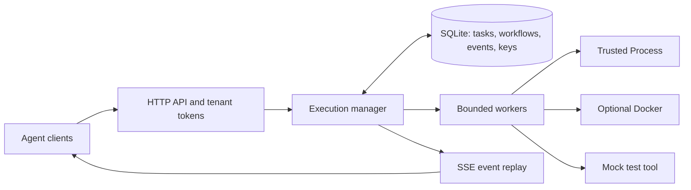

# Toolane architecture and failure semantics

Toolane is a single-machine scheduler for Agent tool calls. One HTTP service
owns one SQLite state directory and a fixed worker pool. Agents choose among
tools that an administrator registered; Toolane validates, queues, runs, and
records each call. It does not plan Agent work or run an LLM.

## Admission and scheduling

The private server config is read once at startup. For Process tools, it fixes
the executable, working directory, environment, argument positions, public
description, JSON Schema subset, and resource policy. Callers provide only
validated JSON arguments. No shell command is assembled, and caller input
cannot replace the executable or environment. A bearer token maps to one
tenant and a set of permitted tool names. The HTTP catalog lists only that
tenant's public definitions.

Admission validates authorization, schema, argument size, tool policy, global
pending capacity, and tenant pending capacity before returning an execution
ID. The default manager has four workers, 256 pending slots globally, 64
pending slots per tenant, and two running slots per tenant. These are source
defaults in `internal/execution/manager.go`; the current HTTP server constructs
the manager with them. Pending includes queued and workflow-blocked work.
Exhaustion returns HTTP 429 rather than admitting an unbounded backlog.

Each worker selects the oldest eligible ready task for the next eligible
tenant, then advances a round-robin cursor. A tenant at its running limit is
skipped until capacity is released. Within a tenant, ready task order is
preserved. A long-running task occupies its worker until the executor returns;
round robin gives other tenants an opportunity when slots are available, but
does not preempt a running tool or guarantee equal completion latency for
different task durations. FIFO remains an internal scheduler mode for
controlled comparisons, not a public HTTP configuration option.

Workflows are static DAGs submitted atomically. Dependencies determine when a
node becomes ready; failure or cancellation skips dependent descendants while
unrelated branches can continue. Node arguments are fixed at submission and
are not interpolated from preceding results.

## Durable state and observable results

SQLite stores accepted executions, workflow structure, snapshots, ordered
events, and idempotency keys. It uses WAL mode and synchronous `FULL`, with a
single database connection. Admission and transition transactions keep task
state and its corresponding event consistent. One service process owns the
state directory. This is a local durability boundary, not a distributed
coordination protocol; multiple service instances must not share it.

The HTTP API returns an execution ID, not a promise of success. Polling returns
the current snapshot. SSE replays persisted events in order and ends with a
terminal event. Queue and run timeouts, cancellation, output limits, process
errors, and result-size limits are distinct visible outcomes. Accepted work
eventually has a terminal state or an explicit unknown state after recovery.

An `Idempotency-Key` is scoped to the authenticated tenant and submission
endpoint. Repeating the same request and key returns the existing execution;
reusing a key with different content conflicts. This prevents duplicate
admission under ordinary request retries. It does not make external effects
exactly once.

## Shutdown, crash, and recovery

On normal cancellation or shutdown, the Process executor signals the tool's
process group and escalates if needed. A trusted child that deliberately
detaches may still require administrator intervention. After a forced kill of
the service process, the service cannot prove that a Process child stopped or
that its file, network, or other external effect did not occur. On restart,
unclaimed queued work is reconstructed and can run; formerly running work is
marked `interrupted` with an unknown execution result. Toolane does **not**
automatically retry it. An operator must compare the execution ID with the
tool process and the external system before deciding whether a new call is
safe. The real-tool tests include an independent report file and append-only
ledger to demonstrate this distinction.

Docker is a separate, optional executor for use cases that need its container
boundary. It is not a prerequisite for the trusted Process path or an implied
sandbox around the HTTP service. When configured, startup checks its pinned
image and policy and reconciles owned resources before opening HTTP admission;
uncertain cleanup is recorded separately from task result. Whether to keep
this backend is the P2 decision, based on its independent value, daemon
dependency, maintenance cost, and actual container test coverage.

## Evidence and limits

The server exposes structured transition logs and optional local `/metrics`.
The [real-tool fixtures](../tests/fixtures/README.md) exercise Process tools
through the public HTTP path, including tenant isolation, DAG behavior,
timeouts, cancellation, crash recovery, and an independent side-effect ledger.
The [experiment runner](../benchmarks/README.md) saves each request's planned
and actual submission time, final state, resource samples, binary and fixture
hashes, and summary percentiles. Its smoke profile verifies wiring; only
controlled repeated runs on the same host can support capacity comparisons.
