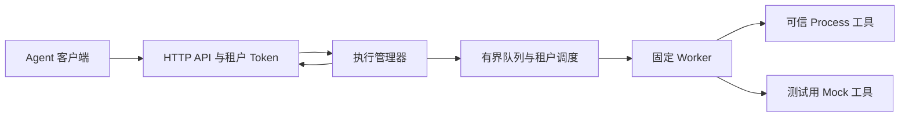

# Toolane 架构与执行语义

Toolane 是面向 Agent 工具调用的单机调度器。服务启动时加载工具注册表和私有配置，创建执行管理器与固定数量的 Worker。调用方提交已获授权的工具名称和 JSON 参数；管理器负责校验、排队、执行、取消和结果查询。

## 准入与调度

HTTP 层把 Bearer Token 映射到租户和工具白名单。执行管理器校验工具是否存在、参数是否符合 Schema 与工具策略、参数大小、超时范围以及全局和租户的待处理容量。默认配置是 4 个 Worker、全局 256 个待处理名额、每租户 64 个待处理名额、每租户 2 个运行名额；管理员可在私有服务配置的 `execution` 段覆盖这些容量与内存终态记录上限。容量用尽时，HTTP 返回 429。

默认调度按租户轮询：每次从具备运行资格的租户中取最早排队的任务；已达到运行上限的租户暂时跳过。同一租户内部保持先进先出。内部配置也支持 FIFO 模式。运行中的工具占用 Worker 直到执行器返回，调度器不抢占工具。

## 任务状态与停止

任务从 `queued` 进入 `running`，最终进入 `succeeded`、`failed`、`timed_out` 或 `cancelled`。运行中接受取消时先进入 `cancelling`，执行器确认停止后才进入终态。队列超时的任务不会调用工具。`GET /api/v1/executions/{id}` 返回状态快照，包含时间戳、错误代码及有限的输出和结果。

任务记录只在服务进程运行期间可查询。服务退出后，原执行 ID 不再可查询；调用方重发请求会创建新的任务，因此有外部副作用的工具应由调用方自行核对结果。

正常取消或关闭服务时，Process 执行器会尝试终止工具进程组。可信程序若自行脱离进程组，可能需要管理员另行处理；管理员也应管理工具产生的外部副作用。Toolane 只运行管理员注册的可信可执行文件，不负责隔离不可信代码。

## 工具定义与观察

Process 工具的服务端配置固定可执行文件、工作目录、环境变量、参数绑定、公开描述、JSON Schema 子集及执行策略。调用方不能改变可执行文件或环境变量，参数不经过 Shell。工具成功退出时，标准输出须是一个 JSON 值。Mock 工具用于本地学习和测试。

服务输出结构化请求与状态转换日志，并始终在独立的本地端口提供 `/metrics`。配置中的 `business_listen` 默认是 `127.0.0.1:8080`，`metrics_listen` 默认是 `127.0.0.1:9090`；两个端口都必须成功监听。代码旁的 Go 测试覆盖准入、调度、超时、取消以及可信 Process 工具的执行行为。
