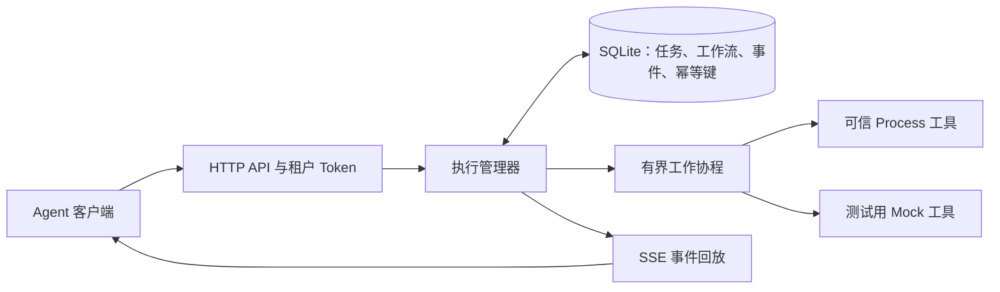

# Toolane 架构与故障语义

Toolane 是面向 Agent 工具调用的单机调度器。一个 HTTP 服务独占一个 SQLite 状态目录，并管理固定数量的工作协程。Agent 从管理员注册的工具中选择要调用的工具；Toolane 负责校验、排队、执行和记录每次调用。它不规划 Agent 的工作，也不运行大语言模型。

## 任务准入与调度

服务启动时读取一次私有配置。对于 Process 工具，配置固定了可执行文件、工作目录、环境变量、参数位置、公开描述、JSON Schema 子集及资源策略。调用方只能提供经过校验的 JSON 参数。服务不会拼接 Shell 命令；调用方输入也不能替换可执行文件或环境变量。Bearer Token 对应一个租户及该租户允许使用的工具名称集合。HTTP 工具目录只列出该租户可见的公开定义。

任务准入在返回执行 ID 前，会校验授权、Schema、参数大小、工具策略、全局待处理容量和租户待处理容量。执行管理器默认有 4 个工作协程、全局 256 个待处理名额、每个租户 64 个待处理名额，以及每个租户 2 个运行名额。这些默认值定义在 `internal/execution/manager.go`，当前 HTTP 服务使用它们创建执行管理器。待处理任务包括排队中和因工作流依赖而阻塞的任务。容量耗尽时返回 HTTP 429，避免接收无界积压。

每个工作协程从下一个具备运行资格的租户中选取最早就绪的任务，然后推进轮转游标。达到运行上限的租户会被跳过，直到释放名额。同一租户内部保留就绪任务的顺序。长时间运行的任务会一直占用工作协程，直到执行器返回；轮转调度让其他租户在有空闲名额时获得运行机会，但不会抢占正在运行的工具，也不保证执行时长不同的任务具有相同的完成延迟。FIFO 仍是供受控对比实验使用的内部调度模式，不是公开的 HTTP 配置项。

工作流是一次性原子提交的静态有向无环图（DAG）。依赖关系决定节点何时就绪；节点失败或取消时，其依赖它的后代节点会被跳过，不相关的分支仍可继续。节点参数在提交时确定，不会从前序节点的结果中插值生成。

## 持久化状态与可观察结果

SQLite 保存已接收的执行、工作流结构、状态快照、有序事件和幂等键。数据库使用 WAL 模式、`FULL` 同步级别及单个数据库连接。任务准入和状态转换在事务中完成，使任务状态及对应事件保持一致。一个状态目录只能由一个服务进程独占。这是本地持久化边界，不是分布式协调协议；多个服务实例不能共享该目录。

HTTP API 返回执行 ID，并不承诺任务一定成功。轮询可获取当前状态快照。SSE 按顺序回放已持久化的事件，并在终态事件后结束。排队超时、运行超时、取消、输出限制、进程错误及结果大小限制都会呈现为可区分的结果。已接收的任务最终会进入终态；如果恢复时无法确定执行结果，则会明确标记为未知状态。

`Idempotency-Key` 的作用范围限定为已认证租户和提交接口。相同请求使用同一键再次提交时，会返回已有的执行；同一键对应不同内容时会发生冲突。这能避免普通请求重试导致的重复接收，但不能保证外部副作用恰好发生一次。

## 关闭、崩溃与恢复

正常取消或关闭服务时，Process 执行器会向工具进程组发送终止信号，并在必要时升级处理。可信子进程如果主动脱离进程组，仍可能需要管理员介入。服务进程被强制终止后，服务无法证明 Process 子进程已经停止，也无法确定它是否产生了文件、网络或其他外部副作用。重启时，未被认领的排队任务会被重建并继续运行；此前正在运行的任务会被标记为 `interrupted`，表示执行结果未知。Toolane **不会**自动重试这类任务。管理员必须核对执行 ID、工具进程及外部系统，再决定是否安全地发起新调用。真实工具测试使用独立报告文件和只追加的记录文件，展示这一差别。

P2 决策移除了 Docker 执行器。Toolane 现在提供可信 Process 执行路径和测试用 Mock 工具，**不提供不可信代码隔离**。[决策与迁移记录](docker-removal.md)说明了对 Docker 守护进程的依赖、测试覆盖情况，以及旧 Docker 状态的处理方式。

## 验证证据与边界

服务提供结构化状态转换日志，以及可选的本地 `/metrics` 接口。[真实工具测试样例](../tests/fixtures/README.md)通过公开 HTTP 路径执行 Process 工具，覆盖租户隔离、DAG 行为、超时、取消、崩溃恢复及独立的副作用记录文件。[实验运行器](../benchmarks/README.md)保存每个请求的计划提交时间与实际提交时间、最终状态、资源采样、二进制与测试样例的哈希，以及各分位数摘要。冒烟测试配置用于确认整条链路可运行；容量对比仍需在同一台机器上进行受控的重复实验。
