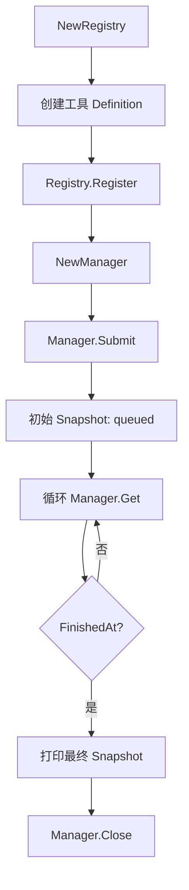
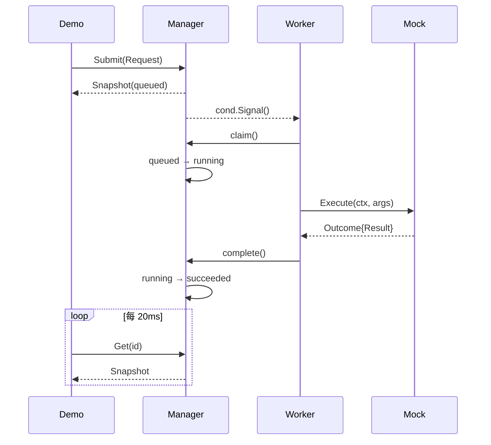

# `main.go` 与最小 Demo

涉及源码：[`cmd/toolane/main.go`](https://github.com/haonox/toolane/blob/main/cmd/toolane/main.go)

`main.go` 同时提供服务模式和一个最小执行示例。后者把 Toolane 的核心组件压缩成一条易于跟踪的路径，是理解项目最合适的入口。

## 命令分流

程序支持三种形式：

```bash
go run ./cmd/toolane
go run ./cmd/toolane process
go run ./cmd/toolane serve --config /absolute/path/config.json
```

`serve` 分支创建一个响应 `SIGINT` 与 `SIGTERM` 的 Context，再进入 `runServer`。其余情况进入 `demo(kind)`：无参数时选择 Mock，参数为 `process` 时运行可信本地进程。

参数使用错误返回退出码 2，运行失败返回退出码 1。这让命令行调用者能够区分“调用方式错误”和“程序执行失败”。

## Demo 组装顺序



注册表只包含服务端认可的工具。Manager 创建时获取注册表快照并启动固定 Worker 池，因此 `Submit` 之后不需要 Demo 自己启动执行 goroutine。

## Mock 分支

Mock 参数是固定 JSON：

```json
{
  "delay_ms": 100,
  "value": "hello from Toolane"
}
```

Executor 等待约 100 毫秒，再返回结构化结果。它不启动真实进程，适合观察队列和状态机。

## Process 分支

Process Demo 由服务端查找 `printf` 的绝对路径，并把请求 JSON 转成参数数组：

```text
{"text":"hello"}
        ↓
["%s\n", "hello"]
```

它没有拼接 Shell 命令。用户输入是 `%s` 对应的独立参数，因此不会被当成 Shell 语法或格式字符串。

## 提交不是同步执行

```go
initial, err := manager.Submit(ctx, request)
```

成功只表示任务已经被接纳。返回的初始状态是 `queued`，真正的执行由后台 Worker 完成。Demo 每 20 毫秒调用一次 `Get`，直到 `FinishedAt` 不为空。



## 资源清理

`demo` 使用命名返回值和 `errors.Join`：

```go
defer func() {
    retErr = errors.Join(retErr, manager.Close(context.Background()))
}()
```

这样既不会丢失主流程错误，也不会吞掉 Manager 关闭错误。

## 本章不变量

- 工具必须先注册，任务才能提交；
- `Submit` 成功不代表执行成功；
- 已接纳任务的生命周期不属于提交 Context；
- `Snapshot` 是观察状态，而不是修改状态的入口；
- 创建 Manager 的调用者负责关闭它。

下一章进入[工具契约与策略](tool-contract.md)，理解 Manager 与 Executor 如何在不互相耦合的前提下合作。
