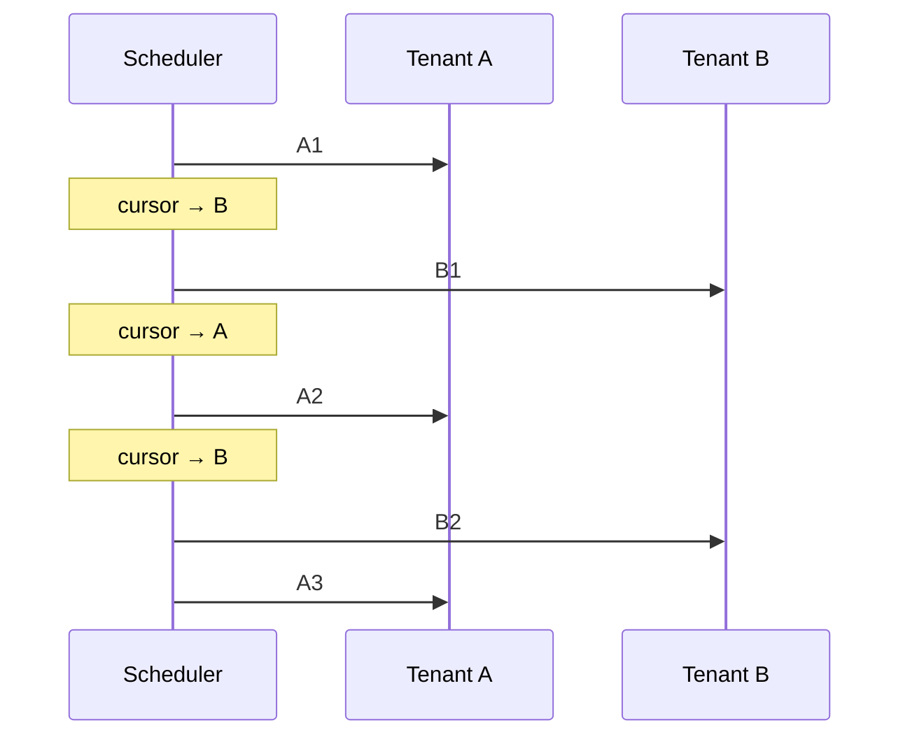
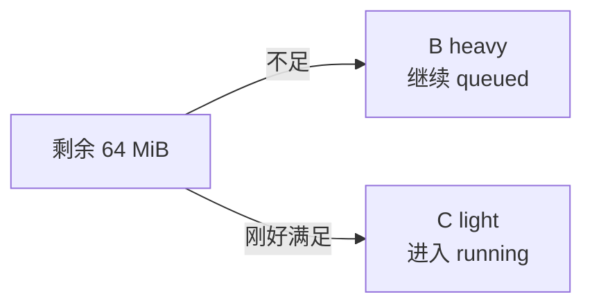

# 多租户调度器

涉及源码：[`internal/execution/scheduler.go`](https://github.com/haonox/toolane/blob/main/internal/execution/scheduler.go)

调度器同时处理三类约束：租户公平性、租户并发上限和沙箱资源预算。它只负责选择任务；状态转换和实际执行仍由 Worker 完成。

## 数据模型

```go
type tenantState struct {
    id      string
    pending int
    running int
}
```

Manager 使用一个全局 `queue` 保存就绪任务，再用 `tenantOrder` 和 `rrCursor` 保存活跃租户的轮询位置。任务通过 `r.tenant` 指向自己的租户状态。

```text
queue       = [A1, A2, A3, B1, B2]
tenantOrder = [A, B]
rrCursor    = 0
```

## Round Robin

默认模式按租户轮询。调度器从 `rrCursor` 开始遍历租户，在全局队列里选择该租户最早且当前可运行的任务，成功后把 cursor 移到下一个租户。



领取顺序是：

```text
A1 → B1 → A2 → B2 → A3
```

FIFO 模式则按全局队列顺序寻找第一个当前可运行的任务，结果通常是 `A1 → A2 → A3 → B1 → B2`。

## “可运行”的含义

`canClaimLocked` 要求同时满足：

```text
租户 running < TenantRunningLimit
任务 CPU <= 剩余全局 CPU
任务内存 <= 剩余全局内存
```

默认每个租户最多同时运行 2 个任务。即使有 4 个空闲 Worker，一个租户也不能占满全部 Worker。

## 避免队头阻塞

假设总内存预算是 256 MiB：

```text
A heavy 正在运行：192 MiB
B heavy 等待：    192 MiB
C light 等待：     64 MiB
```

剩余 64 MiB 放不下 B，但可以运行 C。FIFO 和 Round Robin 都会跳过当前不适配的 B，让 C 先运行。



这里的 FIFO 是“最早的可执行任务”，不是绝对禁止越过队头。

## 原子资源预留

选择任务后，Worker 在同一把 `m.mu` 下调用 `claimSlotLocked`：

```text
tenant.pending--
manager.pending--
tenant.running++
manager.running++
reservedCPU += taskCPU
reservedMemory += taskMemory
```

检查和预留不可分离，否则两个 Worker 可能同时看到相同剩余额度并造成资源超卖。

任务结束时执行相反操作，并 `Broadcast` 所有等待 Worker，因为一次释放可能同时解锁多个租户或资源条件。

## `pending` 与 `blocked`

工作流中：

```text
pending = queued + blocked
```

`queue` 只包含 `queued`，所以统计中的：

```go
Blocked = pending - len(queue)
```

普通单任务没有依赖，通常有 `pending == len(queue)`。

## 租户清理与 cursor 修正

租户没有 pending 和 running 时会从 `tenants` 与 `tenantOrder` 删除，避免大量一次性租户 ID 永久占用内存。删除数组中 cursor 之前的元素时必须同步递减 cursor；删除最后一个元素后还要把越界 cursor 归零。

## 复杂度与公平边界

当前实现选择简单的全局切片：删除任务是 `O(n)`，Round Robin 最坏需要按租户扫描队列。默认队列容量只有 256，这个权衡使实现和不变量更容易验证。

公平性只覆盖“当前符合并发与资源条件”的任务。一个长期放不下的重任务会被跳过；系统没有优先级、权重或未来资源预留。

## 对应测试

重点阅读：

- `TestTenantRoundRobinAndFIFOOrder`：比较两种领取顺序；
- `TestTenantRunningLimitSkipsSaturatedTenant`：饱和租户不能阻挡其他租户；
- `TestTenantContinuousSubmissionDoesNotStarveOtherTenant`：持续提交不能独占队列；
- `TestSandboxBudgetSkipsUnfitReadyWork`：资源不适配任务不会造成队头阻塞。

下一章进入 [DAG 工作流](../workflow/dag.md)。
