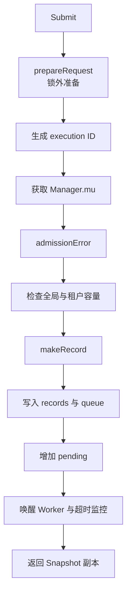

# `Manager.Submit`

涉及源码：[`internal/execution/manager.go`](https://github.com/haonox/toolane/blob/main/internal/execution/manager.go)

`Submit` 把调用方拥有的原始请求，转换成 Manager 拥有、限制已经确定、可以安全调度的内部记录。

## 两阶段接纳



锁外阶段处理不会变化的配置和工具快照；锁内阶段检查并修改共享容量。这样既缩短临界区，又保证容量判断与接纳是原子的。

## `prepareRequest`

准备阶段依次完成：

1. 检查提交 Context；
2. 空租户补成 `local`；
3. 检查 Agent ID 长度；
4. 查找已注册工具；
5. 检查单任务沙箱资源是否可能放入全局预算；
6. 解析最终排队、执行和输出限制；
7. 检查参数大小与 JSON 合法性；
8. 调用工具自己的 `Validate`。

### 参数所有权转换

`json.RawMessage` 本质上是字节切片。Manager 会复制参数：

```go
arguments := append(json.RawMessage(nil), req.Arguments...)
```

否则调用方可能在 `Submit` 返回后修改原切片，使“验证过的参数”和“实际执行参数”不一致，并产生数据竞争。

## 为什么生成 ID 也在锁外

执行 ID 来自 16 个随机字节的十六进制编码。随机数读取不需要访问 Manager 状态，因此在获取全局锁前完成，减少锁占用时间。

## 锁内再次检查 Context

请求可能在准备参数或等待锁的过程中被取消，所以 `admissionError` 再次检查：

```text
ctx 是否已取消
Manager 是否 closing
Manager 是否 halted
```

`closing` 拒绝关机期间的新任务；`halted` 表示存储或执行后端处于无法安全继续的状态。

## 容量检查

普通任务同时受两个 pending 上限约束：

- 全局 `QueueCapacity`，默认 256；
- 单租户 `TenantPendingLimit`，默认 64。

`pending` 指已经接纳、尚未被 Worker 领取的任务。对于工作流，它同时包含 `queued` 和 `blocked`。

## 创建内部记录

普通任务调用：

```go
prepared.makeRecord(id, "", "", now, true)
```

`ready=true` 使初始状态为 `queued`，并同时设置 `CreatedAt`、`ReadyAt` 和排队截止时间。工作流依赖节点会使用 `ready=false`，初始状态是 `blocked`。

## 正式接纳

真正修改共享状态的是：

```go
m.records[id] = r
m.queue = append(m.queue, r)
m.admitPendingLocked(r)
```

随后：

- `cond.Signal()` 唤醒一个 Worker；
- `wakeExpiry()` 通知排队超时监控重新计算最近截止时间；
- 返回深复制的 `Snapshot`。

## 为什么返回状态稳定为 `queued`

虽然先调用了 `cond.Signal()`，但 `Submit` 此时仍持有 `m.mu`。被唤醒的 Worker 必须等 `Submit` 克隆快照并释放锁后才能领取任务，因此普通提交返回的初始快照稳定地是 `queued`。

## 持久化分支

内存 Demo 的 `m.store == nil`，会跳过幂等和数据库写入。Durable Manager 还会在同一临界区处理请求规范化、幂等键、记录保留和事务写入；这些内容在持久化章节展开。

## 本章不变量

- 无效请求在接纳前失败，不消耗容量；
- 参数和返回快照都不能与调用方共享可变内存；
- 容量检查与计数增加必须在同一把锁下；
- 唤醒 Worker 不等于立即执行；
- 接纳成功后，任务生命周期由 Manager 拥有。

下一章跟随被唤醒的 [Worker](worker.md)。
