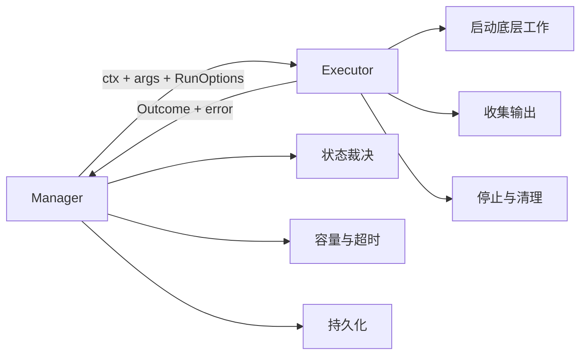
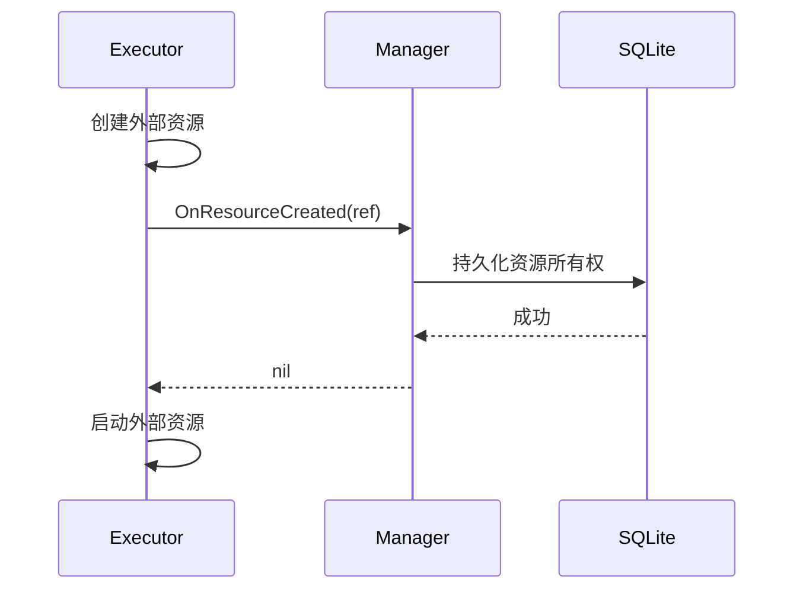

# 工具契约与策略

涉及源码：

- [`internal/tool/registry.go`](https://github.com/haonox/toolane/blob/main/internal/tool/registry.go)
- [`internal/execution/policy.go`](https://github.com/haonox/toolane/blob/main/internal/execution/policy.go)

## `Definition`

每个工具由一个 `Definition` 描述：

```go
type Definition struct {
    Name      string
    Policy    Policy
    Resources Resources
    Validate  func(json.RawMessage) error
    Execute   func(context.Context, json.RawMessage, RunOptions) (Outcome, error)
}
```

`Validate` 在接纳前运行，失败的请求不占用队列容量。`Execute` 由 Worker 调用；Context 取消后，它必须等底层工作停止再返回。

## Manager 与 Executor 的边界



`Outcome` 没有任务状态字段。Executor 只能报告结果、输出、退出码、清理情况和是否确认停止；Manager 结合当前 `StopReason` 决定最终是成功、失败、超时还是取消。

## `RunOptions`

Manager 给 Executor 的可信运行参数包括：

| 字段 | 用途 |
| --- | --- |
| `MaxOutputBytes` | stdout 与 stderr 的总预算 |
| `OnOutputLimit` | 达到输出预算时同步通知 Manager |
| `OnProcessStarted` | 报告底层进程真正启动的时间 |
| `OnCleanupUpdate` | 报告外部资源清理结果 |
| `OnResourceCreated` | 外部资源启动前先持久化其引用 |
| `SandboxResources` | Manager 已经预留的 CPU 和内存 |
| `ExecutionID` | 把底层资源关联到本次执行 |

Docker Executor 创建容器后的正确顺序是：



如果持久化失败，资源不能启动，并且 Executor 必须清理刚创建的资源。

## `StopUnconfirmed`

Executor 返回但不能确认底层工作已经停止时，会设置 `StopUnconfirmed`。Manager 此时暂停接纳和调度：如果直接释放预算，旧工作可能仍在消耗资源，新任务会造成实际超卖。

这是“无法证明安全时停止前进”的故障策略。

## 工具 Policy

工具可以设置自己的排队、执行、输出、参数和结果限制。解析规则是：

```text
全局配置是硬上限
工具只能收紧，不能放宽
工具零值表示继承
请求零值表示使用最终默认值
```

例如全局最大执行时间为 60 秒、工具最大执行时间为 5 秒，那么该工具最多运行 5 秒。工具声明 120 秒会在 Manager 构造时被拒绝。

Mock 没有声明 Policy，因此继承默认值：排队 30 秒、执行 10 秒、输出 1 MiB、参数 256 KiB、结果 64 KiB。

## Registry 冻结

`Registry.Register` 拒绝空定义、非法资源、非法策略和重复名称。Manager 创建时调用 `Registry.Snapshot()`，获得独立 map；之后向原 Registry 注册的新工具不会动态进入已运行的 Manager。

这使运行中的权限与策略保持稳定，也避免提交热路径重复解析工具配置。

## 本章不变量

- Executor 返回前，取消对应的底层工作必须已经停止；
- Executor 报告事实，Manager 决定最终状态；
- 非零沙箱资源必须同时声明 CPU 和内存；
- 工具策略不能突破全局硬上限；
- Manager 构造后，工具集合与有效策略保持不变。

下一章进入 [`Manager.Submit`](submit.md)。
