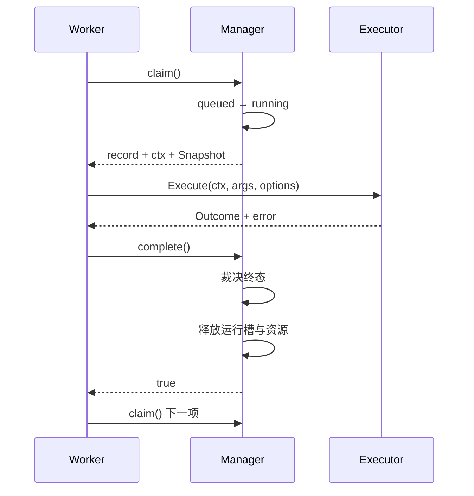

# Worker 生命周期

涉及源码：[`internal/execution/worker.go`](https://github.com/haonox/toolane/blob/main/internal/execution/worker.go)

Worker 把已经接纳的任务从 `queued` 推进到终态。默认配置启动 4 个 Worker，每个 Worker 完成任务后会继续等待下一项。

## Worker 主循环

```text
claim
  → 构建 RunOptions
  → runTool
  → complete
  → 再次 claim
```

当 Manager 关闭或进入不可继续的故障路径时，`claim` 或 `complete` 返回 false，Worker 退出并调用 `workers.Done()`。

## `sync.Cond` 等待

队列没有可运行任务时，Worker 调用 `m.cond.Wait()`。它会原子地释放 `m.mu`、休眠、被通知后重新获取锁。返回后必须重新检查循环条件，因为任务可能已经被其他 Worker 领取，或者 Manager 已进入关闭状态。

## 领取任务

`claim` 在 Manager 锁下完成：

1. 检查 `closing` 和 `halted`；
2. 调用调度器选择一个任务；
3. 再次检查排队截止时间；
4. 持久化 `queued → running`；
5. 创建独立执行 Context；
6. 把 pending 计数转为 running，并预留资源。

如果任务刚好过期，它直接进入 `timed_out`，不会调用 Executor。

## 独立执行 Context

执行 Context 基于 `context.Background()` 和任务执行超时创建，而不是从提交 Context 派生。这样客户端断开不会取消已经被接纳的任务。

运行期间，以下事件可以取消它：

- 用户取消；
- 执行超时；
- 输出达到限制；
- Manager 关闭。

超时回调先把任务改为 `cancelling` 并记录 `execution_timeout`。只有 Executor 返回、确认底层工作停止后，任务才进入最终的 `timed_out`。

## 防止工具 panic 杀死 Worker

`runTool` 用 `recover` 包裹具体 `Execute`。工具 panic 会被转换成普通执行错误，本次任务失败，但服务进程和 Worker 池不会直接崩溃。

## `complete` 的裁决顺序

Executor 返回后，Manager 在锁下复制结果并按以下优先级决定终态：

```text
停止无法确认
→ 已进入 cancelling
→ Executor 返回错误
→ Result 超过限制
→ Result 不是合法 JSON
→ succeeded
```

`cancelling` 再根据 `StopReason` 区分：

| StopReason | 最终状态 |
| --- | --- |
| `execution_timeout` | `timed_out` |
| `output_limit_exceeded` | `failed` |
| 用户取消或服务关闭 | `cancelled` |

这解释了为什么 Executor 不能自己决定最终状态：同一个 `context.Canceled` 在不同停止原因下含义不同。

## 完成后的资源释放

终态写入成功后：

- 清空不再需要的参数；
- 工作流节点通知 DAG 协调器；
- 普通任务加入终态保留队列；
- 减少租户和全局 running；
- 释放沙箱 CPU、内存预算；
- 广播唤醒等待 Worker。



## 本章不变量

- 领取、状态转换和资源预留是同一个锁内操作；
- 任务过期后不能调用 Executor；
- `running` 槽位只在 Executor 返回后释放；
- 终态只能提交一次；
- 工具 panic 被限制在单次执行内。

下一章进入[多租户调度器](scheduler.md)，分析 `claim` 如何选择具体任务。
