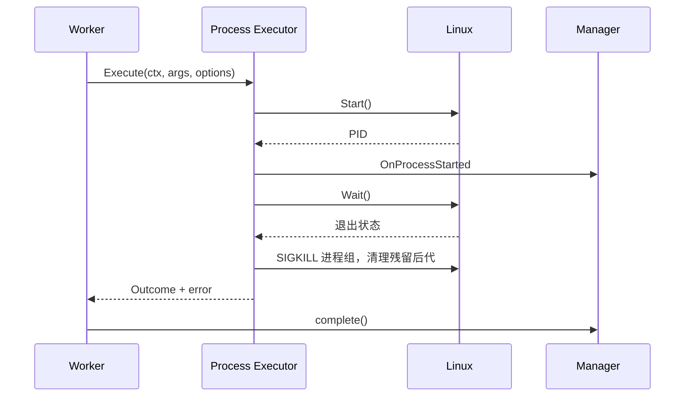
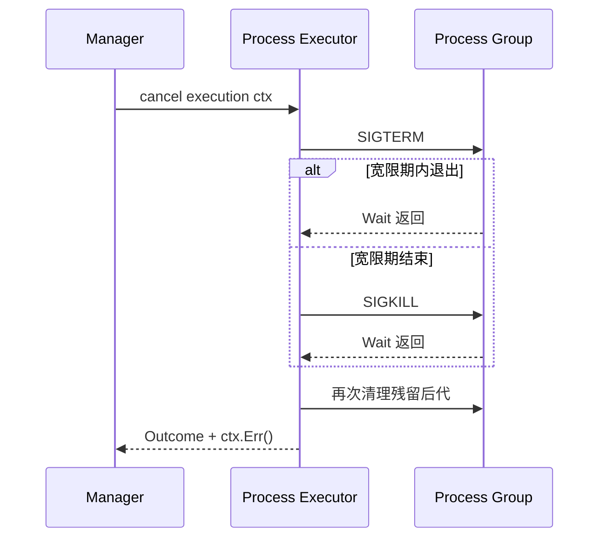

# Process Executor

涉及源码：

- [`internal/executor/process/process.go`](https://github.com/haonox/toolane/blob/main/internal/executor/process/process.go)
- [`internal/executor/process/run.go`](https://github.com/haonox/toolane/blob/main/internal/executor/process/run.go)
- [`internal/executor/process/output.go`](https://github.com/haonox/toolane/blob/main/internal/executor/process/output.go)

Process Executor 运行服务端预先注册的可信 Linux 程序。它不是 Shell，也不是用于不可信代码的沙箱。

## 固定策略

`Spec` 由服务端提供：固定可执行文件绝对路径、参数构造函数、工作目录、完整环境变量、终止宽限期和清理超时。用户请求只能提供交给 `Args` 解析的 JSON，不能选择程序、目录或环境。

`TrustedDefinition` 要求显式 `Trusted=true`。这不是隔离机制，而是提醒注册者确认自己愿意信任该程序。

## 不经过 Shell

执行使用：

```go
exec.Command(spec.Executable, args...)
```

参数数组不会解释 `;`、`|`、`$()` 或重定向。Demo 把用户文本作为 `printf` 的 `%s` 参数，而不是拼成命令字符串。

## 受控环境

`cmd.Env` 使用 `Spec.Environment` 的副本，空列表意味着不继承服务进程环境。固定环境可以避免把 Token 或宿主配置意外传给子进程。

## 进程组

```go
cmd.SysProcAttr = &syscall.SysProcAttr{Setpgid: true}
```

子进程成为新进程组组长，Executor 使用负 PGID 向整个组发送信号。这样普通后代进程不会在父进程停止后继续运行。

Process 后端仍不是强隔离：受信任程序可能主动创建新的会话或采用其他逃离普通进程组的方式。

## 正常运行



即使父进程正常退出，Executor 也会清理同一进程组内仍存在的普通后代。

## 取消与超时

Context 结束后先向进程组发送 `SIGTERM`，等待默认 2 秒宽限期；仍未退出则发送 `SIGKILL`，并等待 `cmd.Wait()` 返回。



如果进程组信号失败，Executor 会尽力杀死直接子进程，但无法确认后代是否停止，于是设置 `StopUnconfirmed`。Manager 随后进入 halted，避免错误释放资源。

## stdout 与 stderr 共享预算

两个输出流共享一个 `outputBudget`。`os/exec` 可能并发写入两个 Writer，因此剩余额度和缓冲区由互斥锁保护。

达到上限后：

1. 只保留预算内的字节；
2. 标记 `OutputTruncated`；
3. 通过 `sync.Once` 调用一次 `OnOutputLimit`；
4. Manager 把任务变成 `cancelling` 并取消 Context；
5. Writer 继续排空管道，但丢弃超预算字节。

Writer 始终返回 `len(p), nil`，避免短写错误，也避免停止读取后让子进程阻塞在已满管道上。

## `WaitDelay`

父进程可能已经退出，但后代仍持有 stdout/stderr 文件描述符，导致 `cmd.Wait()` 一直等待 EOF。`WaitDelay = CleanupTimeout - GracePeriod` 给这种管道等待设置边界，避免 Worker 永久占用。

## 结果映射

| 底层情况 | Executor 错误码 | Manager 结果 |
| --- | --- | --- |
| 退出码 0 | 无 | `succeeded` |
| 非零退出码 | `process_exit_nonzero` | `failed` |
| 无法启动 | `process_start_failed` | `failed` |
| Wait 异常 | `process_wait_failed` | `failed` |
| 用户取消 | `context.Canceled` | `cancelled` |
| 执行超时 | `context.DeadlineExceeded` | `timed_out` |
| 输出达到上限 | Context 被取消 | `failed/output_limit_exceeded` |
| 无法确认停止 | `process_stop_unconfirmed` | Manager halted |

## 对应测试

- `TestProcessRegistrationRequiresExplicitTrustAndAbsolutePath`；
- `TestProcessStreamsAndExitCode`；
- `TestSharedOutputLimitStopsProcess`；
- `TestTimeoutStopsOrdinaryChild`；
- `TestParentExitCleansChildWithClosedPipes`；
- `TestCancelAndCloseRunningProcess`；
- `TestRepeatedCancelAndShutdownReleaseProcesses`。

下一阶段将从 SQLite 开始，把当前内存执行模型升级为可恢复的持久化服务。
