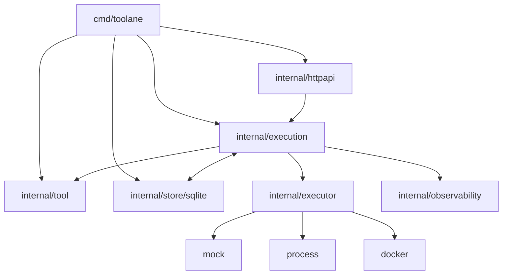
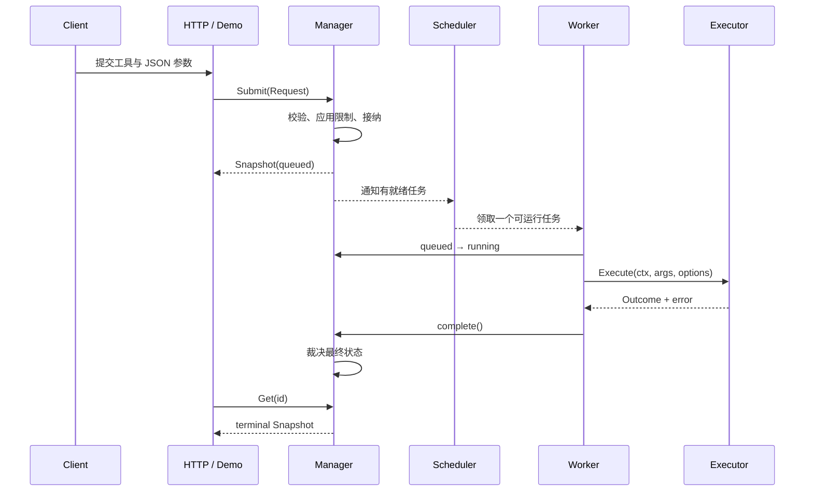

# 整体架构

## 模块边界

| 模块 | 主要职责 | 不应该负责 |
| --- | --- | --- |
| `cmd/toolane` | 组装组件、读取配置、管理服务生命周期 | 决定任务状态机细节 |
| `internal/tool` | 定义工具、策略、资源和执行结果契约 | 调度任务 |
| `internal/execution` | 接纳、状态机、调度、工作流、恢复 | 解析 HTTP 或实现具体沙箱 |
| `internal/executor` | 启动并停止底层工作，报告事实 | 决定最终任务状态 |
| `internal/store/sqlite` | 原子保存记录、事件和幂等键 | 决定业务状态转换 |
| `internal/httpapi` | 认证、租户隔离、协议转换、SSE | 绕过 Manager 直接运行工具 |

## 一次执行的主路径

## 三条核心原则

### Manager 拥有状态机

Executor 只报告退出码、输出、清理状态等事实。超时、取消和完成可能竞争，因此最终状态必须集中裁决。

### 接纳之后由 Manager 拥有任务

提交请求的 Context 只控制接纳过程。任务进入队列后拥有独立的执行 Context，客户端断开不会自动取消已经接纳的工作。

### 资源统计必须对应真实生命周期

Worker 槽位和沙箱预算只有在确认底层工作停止后才能释放。无法确认停止时，Manager 会暂停接纳，而不是假装资源已经安全回收。
