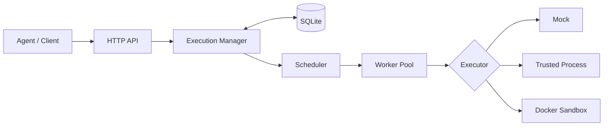

# Toolane 源码学习手册

从一个 100 毫秒的 Mock 任务出发，沿着提交、排队、调度、执行、持久化和恢复逐层理解 Toolane。这里不是 API 清单，而是一份可以与源码并排阅读的实现指南。

[开始学习](guide/reading-path.md){ .md-button .md-button--primary }
[查看源码](https://github.com/haonox/toolane){ .md-button }

---

## Toolane 解决什么问题

Toolane 是一个面向 Agent 工具调用的单机调度与受限执行服务。调用方决定“运行哪个工具”，Toolane 负责“可靠地把它运行完”：

- 固定 Worker 与有界队列；
- 全局容量、租户容量和轮询调度；
- 静态 DAG 工作流；
- Mock、可信 Process 与 Docker 执行后端；
- SQLite 持久化、幂等提交和崩溃恢复；
- HTTP、SSE、结构化日志与管理指标。

## 当前文档覆盖

-   **最小执行链**

    从 `main.go` 进入 `Manager.Submit`，再跟随 Worker 直到任务进入终态。

    [:octicons-arrow-right-24: 开始阅读](execution/main-demo.md)

-   **多租户调度**

    理解 Round Robin、租户并发上限和沙箱资源预算如何共同决定下一个任务。

    [:octicons-arrow-right-24: 阅读调度器](execution/scheduler.md)

-   **DAG 工作流**

    观察节点如何从 `blocked` 进入 `queued`，以及失败如何只传播到依赖分支。

    [:octicons-arrow-right-24: 阅读工作流](workflow/dag.md)

-   **真实本地进程**

    研究 Process Executor 如何管理进程组、输出预算和协作式取消。

    [:octicons-arrow-right-24: 阅读 Process](executors/process.md)

## 阅读约定

每章都尽量回答四个问题：

1. 这个模块拥有什么状态？
2. 它与相邻模块之间的契约是什么？
3. 正常路径和失败路径分别怎样运行？
4. 哪些测试固定了这些行为？

!!! info "版本基线"

    首批章节按提交 `7967fe1` 的实现整理。文档与代码同仓维护；代码行为发生变化时，应在同一个 Pull Request 中更新对应章节。

本文档面向源码学习，不替代 README 中的安装、安全边界和部署说明。

