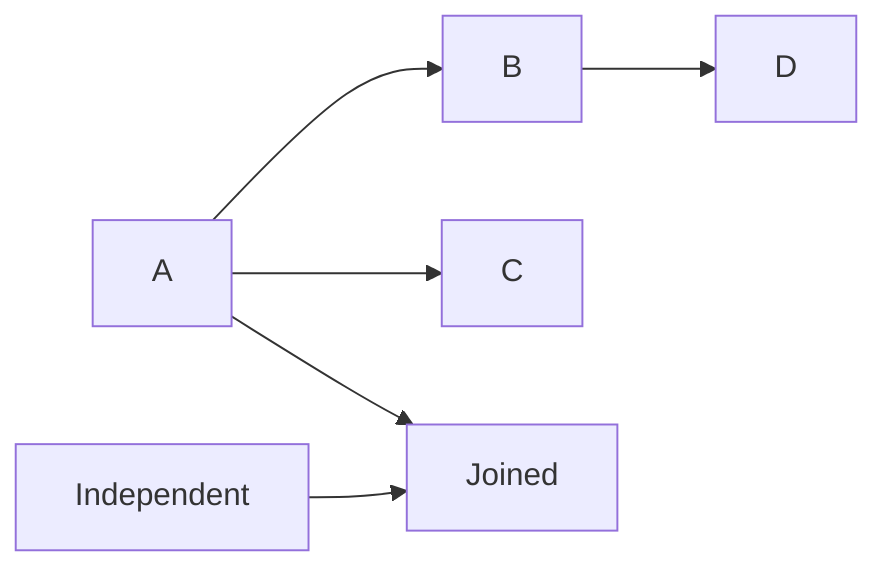
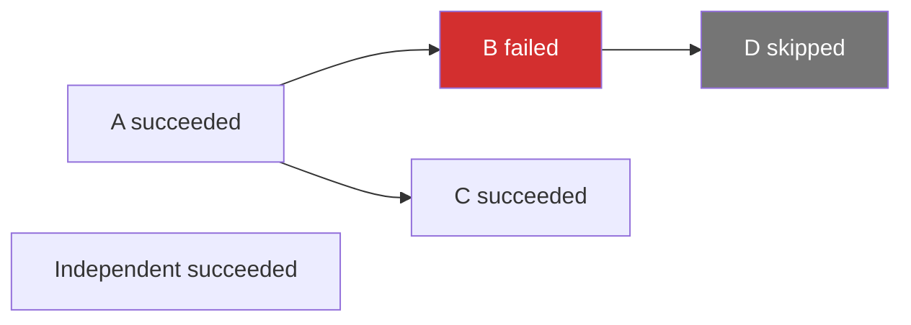

# DAG 工作流调度

涉及源码：[`internal/execution/workflow.go`](https://github.com/haonox/toolane/blob/main/internal/execution/workflow.go)

工作流在普通任务系统上增加依赖协调。它不实现新的执行路径：根节点和解除阻塞的节点最终都进入同一个全局队列，由同一组 Worker 执行。

## 依赖而非数据传递

每个 `WorkflowNode` 包含固定的工具名、参数和直接依赖。上游结果不会自动成为下游参数，因此当前工作流是静态依赖图，不是数据流引擎。



## 原子提交

工作流提交先在锁外验证完整 DAG，并为每个节点执行普通请求的 `prepareRequest`。随后在 Manager 锁下检查整个批次容量、创建全部节点、建立依赖关系并一次性接纳。

只要一个节点、依赖或容量检查失败，整个批次都不会进入 Manager。

## DAG 校验

`validateWorkflow` 检查：

- 节点数和请求大小；
- 非空且唯一的节点 ID；
- 依赖必须存在；
- 不能依赖自身；
- 同一依赖不能重复；
- 图中不能存在环。

环检测使用三色深度优先搜索：未访问、当前递归路径、已经完成。再次遇到“当前递归路径”节点时说明存在环。

节点可以依赖提交数组中位置更靠后的节点；索引建立完成后，依赖名称会转换成数组下标。

## 初始状态

没有依赖的根节点以 `queued` 接纳，并设置 `ReadyAt`；有依赖的节点以 `blocked` 接纳，`ReadyAt` 为空且不进入全局队列。

| 节点 | 初始状态 | 进入 queue | 占用 pending |
| --- | --- | --- | --- |
| 根节点 | `queued` | 是 | 是 |
| 依赖节点 | `blocked` | 否 | 是 |

所有节点都计入全局和租户 pending 上限，因此一个大 DAG 不能用 blocked 节点绕过有界容量。

## 排队超时包含依赖等待

所有节点在工作流接纳时就得到：

```text
deadline = workflow createdAt + queueTimeout
```

因此 Queue Timeout 包括 blocked 等待依赖的时间和 queued 等待 Worker 的时间。父节点执行太久时，子节点可能在 blocked 状态直接超时。

## 双向依赖关系

每个内部节点同时保存：

- `dependsOn`：我在等待的父节点；
- `dependents`：正在等待我的下游节点。

父节点结束时遍历 `dependents`，判断哪些下游受到影响；判断一个下游是否已经完全就绪时再遍历它的 `dependsOn`。

## 成功解锁下游

节点成功后，只有当某个 dependent 的所有父节点都为 `succeeded` 时，才执行：

```text
blocked → queued
设置 ReadyAt
追加到全局 queue
Signal 一个 Worker
```

如果 `Joined` 同时依赖 A 和 Independent，A 成功时它仍可能保持 blocked；第二个父节点成功时才进入队列。

## 失败传播

如果父节点最终不是 `succeeded`，仍处于 blocked 的直接下游会进入：

```text
state      = skipped
error_code = dependency_failed
```

`finishLocked` 会再次调用工作流协调器，所以跳过会递归传播到更深后代。



独立分支 C 和 Independent 不依赖 B，会继续执行。Toolane 不会因为一个节点失败而停止整个 DAG。

## 工作流完成

`remaining` 记录尚未到终态的节点数，`terminalCounted` 防止同一节点重复扣减。最后一个节点结束后：

- 显式取消过整个工作流 → `cancelled`；
- 所有节点成功 → `succeeded`；
- 其他情况 → `failed`。

工作流本身不会汇总成 `skipped` 或 `timed_out`，这些是节点级状态。

## 整体取消

`CancelWorkflow` 在一把锁内：

- 先把工作流设为 `cancelling`；
- blocked 和 queued 节点直接变为 `cancelled`；
- running 节点变为 `cancelling`；
- 收集运行节点的 cancel 函数；
- 释放锁后请求 Executor 停止。

返回的 `cancelling` 表示取消已经被接受，不代表底层进程已经停止。只有运行节点全部返回后，工作流才最终成为 `cancelled`。

## 终态整体保留

工作流结束后，汇总记录和全部节点组成一个 `terminalGroup`。内存结果淘汰时按组删除，避免出现“工作流还存在，但部分节点已经找不到”的不完整视图。

## 对应测试

- `TestWorkflowInvalidGraphsRejectWholeBatch`；
- `TestWorkflowCapacityRejectsWholeBatch`；
- `TestWorkflowDependencySuccessFailureAndIndependentBranch`；
- `TestWorkflowDependencyCannotStartBeforeAllParents`；
- `TestWorkflowBlockedNodeTimeoutSkipsDescendant`；
- `TestWorkflowCancelMarksWholeBatchBeforeStoppingRunner`。

下一章进入真实本地执行后端：[Process Executor](../executors/process.md)。
